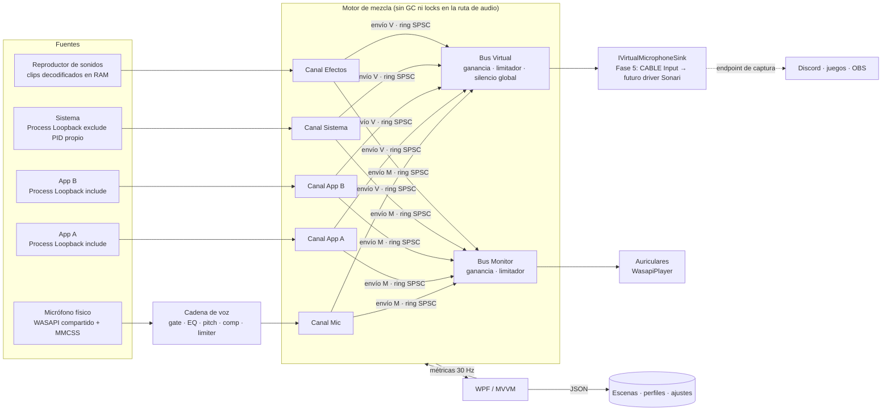

# Sonari — Fase 0: viabilidad, arquitectura y plan

> El proyecto empezó con el nombre en clave «OndaMix» y pasó a llamarse **Sonari** tras la Fase 2.
> Fecha de la investigación: 22/10/2026. Las versiones citadas se comprobaron ese día en NuGet y en Microsoft Learn.

---

## A. Viabilidad técnica y riesgos principales

| Requisito | Viable | Cómo | Necesita código nativo o un driver |
|---|---|---|---|
| Captura del micrófono físico | Sí | WASAPI compartido, por eventos y con MMCSS (NAudio `WasapiRecorderBuilder`) | No |
| Monitoreo por auriculares | Sí | Salida WASAPI independiente (NAudio `WasapiPlayerBuilder`) | No |
| Captura por aplicación | Sí, con límites | Application Loopback (`ActivateAudioInterfaceAsync` + `AUDIOCLIENT_ACTIVATION_TYPE_PROCESS_LOOPBACK`), que NAudio 3.x expone | No: NAudio hace la interop COM |
| Captura del audio del sistema | Sí | Loopback por proceso en modo **exclusión** de nuestro PID (preferente) o loopback WASAPI del dispositivo | No |
| Reproductor de sonidos | Sí | Media Foundation (MP3/AAC/WMA) y WAV, decodificados por adelantado a float 48 kHz | No |
| Mezclador, limitador y medidores | Sí | Motor propio en C#, sin asignaciones en la ruta de audio | No |
| Efectos DSP | Sí | Código C# propio, con NAudio como apoyo puntual | No |
| **Micrófono virtual** | **Sí, pero no solo con C#** | Un **driver de audio en modo kernel** (C/C++ con WDK) o un cable virtual de terceros | **Sí: driver de kernel firmado** |
| Atajos globales | Sí | Win32 `RegisterHotKey` mediante P/Invoke | No (solo P/Invoke) |
| Escenas y perfiles en JSON | Sí | System.Text.Json con escritura atómica | No |
| Transformación de voz con IA | Más adelante | Módulo opcional (ONNX Runtime u otro), con su propio presupuesto de latencia | Depende del modelo |

### Riesgos principales (ordenados por impacto)

1. **El micrófono virtual exige un driver de kernel.** Una aplicación C# no puede crear un dispositivo de captura que Windows reconozca. Para distribuirlo hace falta firma de Microsoft (attestation signing a través de Partner Center), que a su vez exige un **certificado EV**: tiene un coste anual y hay que verificar identidad. **Mitigación:** las fases 1 a 4 no dependen del driver. La Fase 5 usa VB-CABLE (o cualquier cable virtual) tras una interfaz `IVirtualMicrophoneSink`, y el driver propio llega como subproyecto aparte.
2. **El soporte de .NET y Visual Studio.** .NET 8 y .NET 9 **dejan de tener soporte el 10/11/2026** (dentro de 19 días). La LTS vigente es .NET 10 (soporte hasta el 14/11/2028), y **Visual Studio 2022 17.14 no puede compilar para `net10.0`**: se necesita Visual Studio 2026 (18.x). **Mitigación:** apuntar a .NET 10 e instalar VS 2026 Community, que es gratuito y convive con VS 2022. Véase la sección E.
3. **Requisito de Windows para el loopback por proceso.** Microsoft Learn indica como mínimo *Windows 10 build 20348* para `AUDIOCLIENT_ACTIVATION_PARAMS`. En la práctica funciona desde Windows 10 2004 (build 19041): NAudio lo documenta así y OBS lo utiliza. Tu equipo tiene la build **19045 (22H2)**. **Mitigación:** detectarlo en tiempo de ejecución, intentando la activación y mostrando un error claro si falla, en lugar de comparar solo números de versión.
4. **NAudio 3 es joven.** La 3.0 salió el 15/08/2026 y la 3.3.0 el 19/10/2026. Hay un informe de terceros de captura por proceso que entrega silencio en Windows 11 build 26200, aunque el propio proyecto lo achacó después a su forma de informar. **Mitigación:** todo NAudio queda detrás de nuestras interfaces (`Audio.Devices`, `Audio.Capture`, `Audio.Output`). Si falla, se reemplaza por interop COM propia sin tocar el motor.
5. **Deriva de reloj entre dispositivos.** Cada tarjeta, el micrófono USB, el cable virtual y los auriculares tienen su propio reloj, y con el tiempo eso provoca acumulación o vaciado de buffers, que se oyen como clics. **Mitigación:** un buffer por fuente y por bus, con remuestreo adaptativo gobernado por el nivel de llenado (Fase 4) y contadores de underrun/overrun.
6. **Realimentación y duplicación.** Si el audio del sistema se captura del mismo dispositivo por el que monitoreamos, nuestra propia salida vuelve a entrar. **Mitigación:** véase la sección D.3.
7. **GC y tiempo real en .NET.** Una recolección de basura durante la ruta de audio produce cortes. **Mitigación:** buffers preasignados, ninguna asignación ni bloqueo en los callbacks, `GCLatencyMode.SustainedLowLatency` mientras el motor está activo y medición de los tiempos de GC en la Fase 8.
8. **Aplicaciones incapturables.** Las que usan WASAPI exclusivo, ASIO o rutas de audio propias no pasan por el motor compartido de Windows. Se detectarán como «sin audio» y se avisará al usuario.

---

## B. Arquitectura recomendada

Principios:

* **Fuentes → buses → destinos.** Cada fuente (micrófono, aplicación, sistema o reproductor) produce float32 entrelazado a la frecuencia interna (48 kHz por defecto). Hay dos buses de mezcla: **Bus Virtual** (lo que oyen los demás) y **Bus Monitor** (lo que oyes tú). Cada canal tiene un envío independiente a cada bus.
* **El reloj maestro es la salida.** Cada bus se calcula dentro del callback de render de su propio dispositivo de salida: el cable virtual para el Bus Virtual y los auriculares para el Bus Monitor. Las fuentes escriben en buffers circulares SPSC (sin bloqueos), uno por cada bus al que envían.
* **La interfaz nunca toca el audio.** La UI envía comandos (ganancia, silencio, alta o baja de fuentes) al motor y lee métricas (picos, RMS, contadores) mediante sondeo a unos 30 Hz.
* **El silencio global no depende de la UI.** Es un flag atómico que el callback de render lee en cada bloque, y fuerza ceros en el Bus Virtual con una rampa corta para evitar el clic.
* **Separación estricta.** El motor no conoce WPF, la interfaz no conoce NAudio y el driver es un componente externo.

### Contratos del motor (se implementan en la Fase 2; este es el borrador)

```csharp
// Audio.Core
public interface IAudioSource : IAsyncDisposable
{
    SourceId Id { get; }
    SourceKind Kind { get; }              // Microphone, Application, System, Player
    SourceState State { get; }            // Stopped, Starting, Running, WaitingForProcess, Faulted
    AudioFormat NativeFormat { get; }
    Task StartAsync(CancellationToken ct);
    Task StopAsync(CancellationToken ct);
    // El hilo de captura escribe en los SpscRingBuffer de los buses suscritos.
}

public interface IOutputBus
{
    BusId Id { get; }                     // Virtual, Monitor
    // Se llama desde el hilo de render: mezcla, limita y escribe en el destino.
    void Render(Span<float> interleaved);
}
```

Cambios de parámetros: valores `volatile float` con rampa por muestra. Cambios de topología (añadir o quitar una fuente): se publica un *snapshot* inmutable del grafo mediante `Interlocked.Exchange`, y el snapshot anterior se libera fuera del hilo de audio.

---

## C. Estrategia para el micrófono virtual

### C.1 Qué es posible y qué no

* **No es posible** registrar un dispositivo de captura persistente desde una aplicación C# normal. Los endpoints de audio de Windows los crea un driver de audio en **modo kernel**: un miniport PortCls WaveRT o un driver ACX sobre KMDF. Windows no admite drivers de audio en modo usuario (UMDF).
* Cualquier producto de este tipo (Voicemod, VB-CABLE, VoiceMeeter, NVIDIA Broadcast) instala un driver propio.

### C.2 Opciones comparadas

| Opción | Lenguaje | Instalación | Distribución a amigos | Latencia | Nombre configurable |
|---|---|---|---|---|---|
| **VB-CABLE** (VB-Audio) | ― | Instalador oficial (admin) | Cada usuario lo descarga de vb-audio.com. Es *donationware* y no puede incluirse en nuestro instalador sin acuerdo con VB-Audio (más de 10 unidades) | Baja, configurable en su panel | No («CABLE Output»), aunque Windows permite renombrar el endpoint |
| **Virtual-Audio-Driver** (VirtualDrivers, MIT + MS-PL, derivado de SYSVAD) | C/C++ | Manual y en **beta**, requiere *test signing* | No es apto para usuarios finales hoy | Sin medir | Sí, compilándolo nosotros |
| **Driver propio derivado de SYSVAD** (PortCls/WaveRT) | C/C++ con WDK | INF + `pnputil` (admin) | Sí, **con attestation signing** (Partner Center + certificado EV) | La más baja posible | Sí: «Sonari Virtual Microphone» |
| **Driver propio ACX** | C/C++ con WDK | Igual que el anterior | Igual que el anterior | Igual | Sí |

### C.3 Decisión

1. **Fases 1 a 5 (desarrollo y uso entre amigos):** la salida va a un **cable virtual existente**. El motor renderiza en «CABLE Input» y Discord o el juego seleccionan «CABLE Output» como micrófono. La interfaz `IVirtualMicrophoneSink` y una implementación `CableEndpointSink` (cualquier par render/captura) hacen la sustitución transparente. La aplicación **detecta** el cable y lo muestra como «cable virtual de terceros»: nunca dice que es nuestro micrófono.
2. **Subproyecto `driver/` (C++, después de la Fase 5):** un driver propio basado en el sample **SYSVAD** de Microsoft (o un fork de Virtual-Audio-Driver tras auditarlo), en dos pasos:
   * **Paso 1, par en bucle:** un endpoint de render oculto o discreto y un endpoint de captura «Sonari Virtual Microphone». Es el mismo modelo que un cable, de modo que el motor no cambia.
   * **Paso 2, ruta directa:** solo un endpoint de captura, alimentado por un buffer compartido entre el motor y el driver mediante IOCTL. Da menos latencia y oculta el endpoint de render, pero es más complejo y exige validar ACL y entradas en el kernel.
   * Se elige PortCls/WaveRT frente a ACX porque SYSVAD es el sample de referencia más maduro y cubre Windows 10 y 11. ACX 1.1 figura en la documentación con soporte desde Windows 10 2004, pero hay menos ejemplos. La decisión se revisará al empezar el driver.

### C.4 Firma, instalación y permisos del driver

* **Desarrollo:** *test signing* (`bcdedit /set testsigning on`, con Secure Boot desactivado) y un certificado de prueba propio. **Nunca** debe pedírsele a un amigo que desactive Secure Boot.
* **Distribución:** desde Windows 10 1607, con Secure Boot, un driver de kernel nuevo debe estar firmado por Microsoft. Para el *attestation signing* hace falta una cuenta de Hardware Dev Center en Partner Center con **al menos un certificado EV** asociado y archivos firmados con SHA-256. El attestation signing solo vale para Windows 10/11 de escritorio y no sirve para publicar en Windows Update para usuarios minoristas (eso requiere las pruebas HLK y WHCP completas).
* **Compatibilidad:** x64 (y ARM64 compilado aparte), compatible con HVCI (integridad de memoria), sin APIs de kernel obsoletas.
* **Instalación:** requiere administrador (`pnputil /add-driver sonari.inf /install`, o crear un dispositivo raíz con `devcon`/SwDevice). La aplicación **no** necesita administrador; solo el instalador del driver.
* **Requisitos de desarrollo:** la carga de trabajo «Desarrollo para el escritorio con C++» de Visual Studio, el Windows SDK y el WDK de la misma versión. Hoy no tienes ninguno instalado: no hace falta hasta el subproyecto del driver.

---

## D. Captura de aplicaciones individuales

### D.1 API

* **Application Loopback:** `ActivateAudioInterfaceAsync(VIRTUAL_AUDIO_DEVICE_PROCESS_LOOPBACK, IID_IAudioClient, AUDIOCLIENT_ACTIVATION_PARAMS{ ActivationType = PROCESS_LOOPBACK, ProcessLoopbackParams = { TargetProcessId, PROCESS_LOOPBACK_MODE_INCLUDE_TARGET_PROCESS_TREE } })`.
* **En NAudio 3.3.0** (verificado en el XML de la API del paquete):
  ```csharp
  await using var recorder = await new WasapiRecorderBuilder()
      .WithProcessLoopback((uint)pid, ProcessLoopbackMode.IncludeTargetProcessTree)
      .WithFormat(WaveFormat.CreateIeeeFloatWaveFormat(48000, 2))
      .WithMmcssThreadPriority("Pro Audio")
      .BuildAsync();            // obligatorio para el loopback por proceso
  recorder.DataAvailable += (span, flags, devicePos, qpcPos) => { /* copiar al ring buffer */ };
  recorder.StartRecording();
  ```
  El dispositivo virtual de loopback no tiene *mix format*, así que el formato lo fijamos nosotros (48 kHz, estéreo, float). **Si el proceso no reproduce nada, no llegan paquetes**: la fuente se trata como «discontinua» y genera silencio, lo que no cuenta como underrun.

### D.2 Selector de procesos

* **Actividad de audio:** se enumeran las sesiones de audio (`AudioSessionManager`, `IAudioSessionControl2`) de cada endpoint de render. Eso da el PID, el estado (activa o inactiva) y el **nivel de pico por sesión** (`AudioMeterInformation`) **antes** de empezar a capturar.
* **Nombre, ruta e icono:** `QueryFullProcessImageName` con `PROCESS_QUERY_LIMITED_INFORMATION`, que funciona con la mayoría de procesos sin elevación, y el icono mediante `SHGetFileInfo` + `Imaging.CreateBitmapSourceFromHIcon`, sin depender de System.Drawing.
* **Aplicaciones multiproceso** (Chrome, Edge, Discord, Spotify y Electron en general): el audio suele salir de un proceso hijo. Se agrupa por ejecutable y se captura el **proceso raíz** en modo *include tree*. El padre se obtiene con `CreateToolhelp32Snapshot` (`th32ParentProcessID`).
* **Varias instancias:** se muestran por separado (PID, título de ventana y hora de inicio) y el usuario elige.
* **Identidad persistente:** una escena guarda la **ruta del ejecutable**, no el PID. Si el proceso termina, la fuente pasa a «Esperando a la aplicación» y se vuelve a enganchar sola cuando reaparece (sondeo cada 2 s, sin WMI).

### D.3 Audio del sistema, duplicación y realimentación

| | Loopback WASAPI del dispositivo | Application Loopback por proceso |
|---|---|---|
| Qué captura | Todo lo que suena en **un endpoint**, incluida **nuestra propia salida** | Lo que renderiza **un árbol de procesos**, en cualquier endpoint |
| Exclusiones | Ninguna | Modo `ExcludeTargetProcessTree`: «todo menos un árbol» |
| Formato | El *mix format* del dispositivo | El que pidamos |
| Riesgo | Realimentación si monitoreamos por ese dispositivo | Solo admite **un** PID por instancia |

* **«Audio del sistema» por defecto** = loopback por proceso **excluyendo nuestro propio PID**, de modo que ni el monitoreo ni los sonidos del reproductor vuelven a entrar. El loopback del dispositivo queda como opción avanzada, con aviso si coincide con el dispositivo de monitoreo.
* **Duplicación** (sistema + aplicación X capturada aparte): el modo exclusión no admite varios PID. Hay dos soluciones:
  1. Aviso y acción rápida («X ya está en el sistema: ¿desactivar su envío al micrófono?»).
  2. Modo avanzado (Fase 8): construir el «sistema» como la suma de cada sesión activa capturada individualmente, menos las ya seleccionadas y la nuestra. Consume más recursos y puede perder sonidos del sistema sin PID.
* **Realimentación del micrófono virtual:**
  * El Bus Monitor **nunca** se encamina al Bus Virtual: lo impone la estructura, no una opción.
  * Si el render del cable («CABLE Input») es la salida predeterminada de Windows, todo el audio del PC acabaría en el micrófono. Se detecta y se avisa.
  * Si se captura una aplicación de llamadas (Discord, Teams o Zoom), los demás oirían su propia voz con retardo. Se avisa al seleccionarla.

### D.4 Limitaciones conocidas

* Las aplicaciones que usan WASAPI **exclusivo** o ASIO no se pueden capturar.
* Los procesos protegidos o elevados pueden impedir leer la ruta o el icono. La captura en sí se verificará en la Fase 3 y no se promete.
* Medido en la Fase 3: **el volumen de la aplicación en el mezclador de Windows sí afecta a la captura.** Si la silencias o la bajas en Windows, en Sonari llega silenciada o más baja.

---

## E. Tecnologías, bibliotecas y versiones (verificadas el 22/10/2026)

| Componente | Versión | Licencia | Motivo y notas |
|---|---|---|---|
| **.NET** | **10 (LTS)**, soporte hasta el 14/11/2028 | MIT | .NET 8 y 9 terminan su soporte el 10/11/2026 |
| **IDE** | **Visual Studio 2026 Community (18.x)** | Gratuito (uso individual y OSS) | VS 2022 17.14 solo compila hasta `net9.0`; `net10.0` requiere VS 18.0 o posterior. Puede instalarse junto a VS 2022 |
| WPF + XAML | incluido en .NET 10 | MIT | Requisito del proyecto |
| CommunityToolkit.Mvvm | 8.4.2 | MIT | `ObservableObject` y `RelayCommand` con generadores de código, sin reflexión ni runtime pesado |
| Microsoft.Extensions.Hosting | 10.0.13 | MIT | DI, logging y ciclo de vida (`IHostedService` para el motor) en una sola pieza estándar |
| **NAudio.Wasapi / NAudio.Core** | **3.3.0** | MIT | WASAPI moderno: `WasapiRecorderBuilder` (`WithProcessLoopback`, `WithLowLatency` con IAudioClient3, `WithMmcssThreadPriority`), `WasapiPlayerBuilder`, sesiones, Media Foundation y `WdlResampler`. Requiere `net9.0` o superior. La 2.x no tiene loopback por proceso |
| Serilog.Extensions.Logging + Serilog.Sinks.File | 10.0.0 / 7.0.0 | Apache-2.0 | Logs a archivo rotativos para diagnóstico (Microsoft.Extensions.Logging no incluye proveedor de archivos) |
| xunit.v3 + xunit.runner.visualstudio + Microsoft.NET.Test.Sdk | 4.0.2 / 4.0.1 / 18.11.0 | Apache-2.0 / MIT | Pruebas desde el Explorador de pruebas y desde `dotnet test` |
| System.Text.Json | incluido | MIT | Persistencia |

**Descartado por ahora:**

* Suites de controles WPF (MahApps, WPF-UI): un tema propio cuesta poco y evita depender de terceros.
* SoundTouch (LGPL, C++): el cambio de tono será propio o con `SmbPitchShifter` de NAudio para empezar, y se evaluará su calidad en la Fase 6.
* Bibliotecas de atajos: `RegisterHotKey` basta.

**Más adelante:**

* Instalador (Fase 9): WiX v6 o Inno Setup. MSIX no puede instalar drivers de kernel.
* IA (posterior a la Fase 6): ONNX Runtime (MIT), como módulo opcional.

---

## F. Diagrama de componentes y flujo de audio



Reglas del diagrama:

* `BM` nunca alimenta a `BV`.
* `SYS` excluye nuestro PID.
* Cada bus lo cronometra su propio dispositivo de salida, y cada ring buffer compensa la deriva.

### Presupuesto de latencia inicial (a medir, no prometido)

| Tramo | Objetivo inicial | Cómo se mide |
|---|---|---|
| Captura del micrófono (periodo WASAPI) | 10 ms (3–5 ms con IAudioClient3, si el driver lo admite) | `LatencyMilliseconds` de NAudio y QPC de cada paquete |
| Buffer de fuente (jitter y deriva) | 10–20 ms | Nivel de llenado del ring |
| Proceso y mezcla | menos de 2 ms de CPU por bloque de 10 ms | Cronómetro por bloque, p50 y p99 |
| Render al cable | 10–20 ms | `GetPosition` y QPC |
| Cable virtual + lectura de la aplicación destino | Depende del cable y de la aplicación | Prueba de bucle con un clic: inyectar, grabar «CABLE Output», correlacionar |
| **Total micrófono → endpoint virtual** | **≤ 40 ms** (objetivo de ingeniería) | Prueba de bucle en la Fase 8 |
| **Monitoreo micrófono → auriculares** | **≤ 50 ms** | Igual |

---

## G. Estructura de la solución

```
Sonari/
├─ Sonari.sln
├─ Directory.Build.props          # TFM común, nullable, versión
├─ Directory.Packages.props       # versiones centralizadas de NuGet
├─ .editorconfig  .gitignore  .gitattributes  README.md
├─ docs/
├─ src/
│  ├─ Sonari.App/                # exe WPF: composición (Host), arranque, instancia única
│  ├─ Sonari.Presentation/       # Vistas XAML, ViewModels, tema, controles
│  ├─ Sonari.Audio.Core/         # Contratos, formatos, ring buffers, dB (sin dependencias)
│  ├─ Sonari.Audio.Devices/      # Endpoints WASAPI (NAudio): enumeración, capacidades, notificaciones
│  ├─ Sonari.Infrastructure/     # JSON, rutas, ajustes
│  ├─ Sonari.Audio.Capture/      # Fase 2–3: micrófono, sistema, por proceso
│  ├─ Sonari.Audio.Engine/       # Fase 2+: canales, buses, deriva, DSP básico y supervisor (sin NAudio)
│  ├─ Sonari.Audio.Playback/     # Fase 4: reproductor de sonidos
│  ├─ Sonari.Audio.Output/       # Fase 2: render de monitoreo y del bus virtual
│  ├─ Sonari.VirtualAudio/       # Fase 5: IVirtualMicrophoneSink, detección de cable y driver
│  └─ Sonari.Audio.Effects/      # Fase 6: DSP
├─ tests/
│  └─ Sonari.UnitTests/          # Pruebas sin hardware (se dividirá cuando crezca)
└─ driver/                        # Subproyecto C++/WDK posterior a la Fase 5
```

* **`Audio.Devices`** no estaba en la lista original. Existe porque Capture, Output y VirtualAudio necesitan la misma capa de endpoints, y así NAudio no se filtra a Core.
* **`Audio.Engine`** sustituye al «Audio.Mixing» previsto (cambio de la Fase 2). El supervisor del motor necesita el grafo de mezcla y las interfaces de captura y salida, pero no sus implementaciones. Así sigue sin depender de NAudio y se prueba con dispositivos simulados.
* Los proyectos se crean **en la fase que les da contenido**, para no tener proyectos vacíos. La Fase 1 crea App, Presentation, Audio.Core, Audio.Devices, Infrastructure y UnitTests.

Dependencias permitidas:

* `Core` ← todos.
* `Devices`, `Capture` y `Output` ← NAudio.
* `Presentation` → `Core` + `Infrastructure` (nunca NAudio).
* `App` → todos.

---

## H. Plan por etapas y criterios de aceptación

| Fase | Entregable | Criterio de aceptación verificable |
|---|---|---|
| **1. Base** | Solución, MVVM, tema oscuro, navegación, ajustes JSON, logs, enumeración de dispositivos, instancia única | Compila sin errores en VS 2026. La app abre y muestra las 7 secciones. Los dispositivos reales aparecen. Un ajuste guardado sobrevive al reinicio. Se crea el log. Una segunda instancia se bloquea. Las pruebas pasan |
| **2. Motor básico** | Captura del micrófono → ring → monitoreo por auriculares; medidor; contadores de underrun y overrun; recuperación al desconectar | 10 minutos de micrófono → auriculares sin cortes audibles y con los contadores estables. Al desconectar los auriculares no hay crash y el motor se recupera al reconectarlos |
| **3. Captura por proceso** | Selector de procesos (icono, PID, actividad, nivel), canal por aplicación, reenganche | Capturar el navegador con Spotify sonando a la vez **no** incluye Spotify. Cerrar y reabrir el navegador lo reengancha |
| **4. Mezclador y reproductor** | Canales con ganancia, balance, silencio y envíos V/M; limitador; deriva; panel de sonidos y parada de emergencia | Micrófono + 2 aplicaciones + 3 sonidos simultáneos sin clipping (pico ≤ −0,3 dBFS tras el limitador). La parada de emergencia corta en menos de 20 ms |
| **5. Micrófono virtual** | `IVirtualMicrophoneSink` + cable de terceros; detección y avisos de realimentación | Discord (o la grabadora de Windows) recibe la mezcla desde «CABLE Output». El monitoreo no aparece en esa grabación |
| **6. Efectos de voz** | Cadena configurable: gate, HPF, EQ, compresor, limitador, pitch, eco, reverb, distorsión, modulación | Cada efecto tiene pruebas offline (respuesta a impulso o seno) y un bypass sin clics |
| **7. Escenas y atajos** | Escenas en JSON, `RegisterHotKey`, conflictos | 5 escenas persisten tras reiniciar. Cambiar de escena no reinicia los dispositivos. Un atajo ocupado se informa |
| **8. Robustez** | Pruebas de latencia en bucle, CPU, memoria, GC, desconexiones y estrés | 1 hora con 6 fuentes: memoria estable, ≤ 5 % de CPU en un equipo medio y 0 underruns sin causa externa |
| **9. Distribución** | Instalador, primer arranque guiado, paquete de diagnóstico y documentación para el usuario | Un amigo instala la app y el cable siguiendo la guía, sin ayuda |
| **Driver** (paralelo, tras la 5) | Driver SYSVAD propio, primero con test signing y después con attestation | El endpoint «Sonari Virtual Microphone» recibe la mezcla en una máquina de pruebas |

### Plan de pruebas

* **Unitarias (sin hardware):**
  * Ring buffers (vuelta, overrun, underrun, concurrencia productor/consumidor).
  * Conversiones de dB.
  * Mezcla y limitador con señales sintéticas (seno, impulso, ruido).
  * Rampas de ganancia (sin discontinuidades).
  * Remuestreo y deriva (frecuencia de entrada distinta de la de salida durante N minutos simulados).
  * Serialización de escenas y versiones de esquema.
  * Heurísticas de dispositivos virtuales y de agrupación de procesos.
* **Integración (con hardware, manuales o semiautomáticas):** captura → render en bucle con un cable virtual, medición de la latencia con un clic, desconexión en caliente y captura por proceso con dos reproductores.
* **Aceptación:** los 14 puntos del enunciado, cada uno asignado a la fase anterior que lo demuestra.

---

## I. Primeros pasos exactos

1. Instala **Visual Studio 2026 Community** con la carga de trabajo **«Desarrollo de escritorio de .NET»**, que incluye el SDK de .NET 10. Puede convivir con VS 2022.
2. Comprueba el SDK en una terminal: `dotnet --list-sdks` debe mostrar una línea `10.0.x`.
3. Abre `Sonari.sln` en VS 2026.
4. Haz clic derecho en `Sonari.App` → **Establecer como proyecto de inicio**.
5. Ejecuta **Compilar → Recompilar solución** y espera **0 errores**.
6. Pulsa **F5**.
7. Abre **Prueba → Explorador de pruebas → Ejecutar todas**.

Desde la línea de comandos, en la carpeta de la solución:

```
dotnet build Sonari.sln -c Debug
dotnet test Sonari.sln
dotnet run --project src/Sonari.App
```

**Clona el repositorio en una ruta corta** (p. ej. `C:\dev\Sonari`). Se comprobó en la Fase 1 que, con rutas de más de 260 caracteres, el compilador XAML de WPF omite las vistas sin dar error de compilación, y la app falla al arrancar con *«No se encuentra el recurso 'views/mainwindow.xaml'»*.

**Si de momento debes usar VS 2022:** cambia `SonariNet` a `net9.0` en `Directory.Build.props`. Compila igual, pero .NET 9 se queda sin soporte el 10/11/2026: tómalo solo como un puente temporal.

---

## Fuentes

* Soporte de .NET: https://dotnet.microsoft.com/platform/support/policy/dotnet-core
* .NET SDK, MSBuild y versiones de Visual Studio: https://learn.microsoft.com/dotnet/core/porting/versioning-sdk-msbuild-vs
* `AUDIOCLIENT_ACTIVATION_PARAMS`: https://learn.microsoft.com/windows/win32/api/audioclientactivationparams/ns-audioclientactivationparams-audioclient_activation_params
* Sample de Application Loopback: https://learn.microsoft.com/samples/microsoft/windows-classic-samples/applicationloopbackaudio-sample/
* `ActivateAudioInterfaceAsync`: https://learn.microsoft.com/windows/win32/api/mmdeviceapi/nf-mmdeviceapi-activateaudiointerfaceasync
* NAudio 3 (README, `WasapiRecorder.md`, `WasapiPlayer.md`, `MigratingFromNAudio2.md`): https://github.com/naudio/NAudio
* Versiones de ACX: https://learn.microsoft.com/windows-hardware/drivers/audio/acx-version-overview
* Firma de drivers: https://learn.microsoft.com/windows-hardware/drivers/dashboard/code-signing-reqs
* VB-CABLE y licencias: https://vb-audio.com/Cable/ · https://shop.vb-audio.com/en/content/3-Terms-of-use
* Virtual-Audio-Driver: https://github.com/VirtualDrivers/Virtual-Audio-Driver
